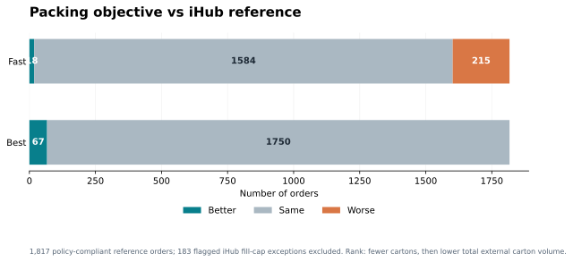
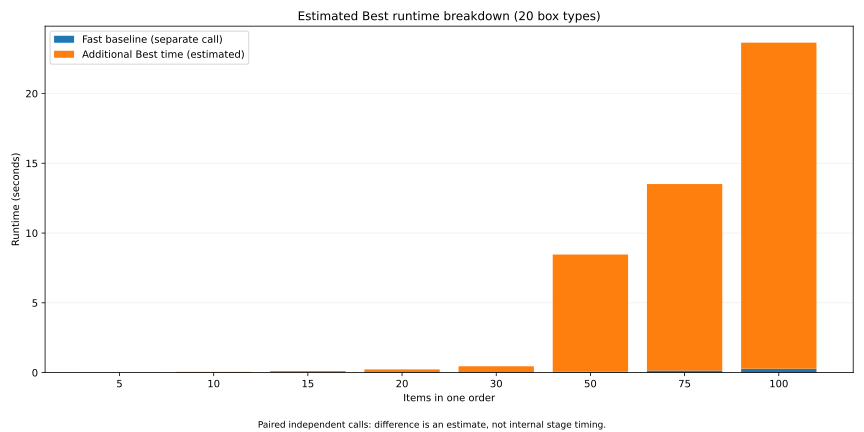

# iHub Solutions Capstone Project Closure Report

| Field | Details |
| --- | --- |
| Project | 3D Bin Packing Solver: Carton Recommendation Optimization |
| Programme | NUS Industry 4.0 Master's Capstone |
| Industry context | iHub Solutions |
| Report date | 22 November 2026 |
| Delivery status | Core capstone implementation and evaluation completed |
| Closure disposition | Recommended for formal closure, subject to academic and stakeholder acceptance |
| Source of record | [Project repository](https://github.com/Voycepeh/ihubsolutions-capstone-project) |

## 1. Executive summary

This capstone designed, implemented and evaluated a reusable three-dimensional (3D) carton recommendation engine using masked historical iHub order data. The purpose was to investigate whether a configurable packing optimizer could offer better carton choices while respecting operational constraints and making computation time measurable.

The delivered solution provides two operating modes. **Fast** uses a heuristic placement strategy, including bounded improvement attempts, to prioritize response time. **Best** first establishes a valid Fast solution, then uses Google OR-Tools CP-SAT to search for an improved packing within a configurable additional time budget. Both strategies return packing details through a common Python API and are subject to independent geometric and policy validation.

The saved 2,000-order comparison provides evidence of improvement potential. After excluding 183 cases affected by historical Box9 fill-policy differences, Best achieved **67 better, 1,750 equivalent and zero worse** ranked carton outcomes over 1,817 eligible orders, relative to the recorded iHub baseline. These are *recommendation-quality comparisons*, not measured production savings.

The core technical, evaluation and documentation objectives are completed. The project is therefore **recommended for capstone closure**; production implementation would require a separate operational validation and adoption decision.

## 2. Objectives and completed work

| Objective | Delivered outcome | Evidence |
| --- | --- | --- |
| Build an independent carton recommendation engine | Reusable Python `solve_order()` API accepts an order, a caller-supplied carton catalogue and configurable packing rules | [README: Public API](../README.md#public-api), [product specification](../src/PRODUCT_SPEC.md) |
| Compare practical optimization strategies | Fast heuristic and Best CP-SAT modes, with bounded Best search and a validated Fast fallback | [Fast guide](fast-solver-under-the-hood.md), [Best guide](best-solver-under-the-hood.md) |
| Enforce feasibility and operational policy | Independent validation of placements, permitted orientations, carton weights, usable dimensions, fill and item completeness | [README: Constraint validation](../README.md#high-level-architecture), [guardrail simulation](../notebooks/Simulated%20Rule%20Proof.ipynb) |
| Evaluate quality against a historical reference | Saved 2,000-order benchmark with explicit eligibility criteria and a consistent ranked carton objective | [Benchmark CSV](../notebooks/artifacts/benchmark_2000_best_vs_ihub.csv), [comparison code](../notebooks/benchmark_comparison.py) |
| Examine performance tradeoffs | Saved Fast/Best scaling results and a notebook comparing Fast, Best and recorded iHub service latency | [Scaling visualizations](../benchmark_results/solver_scaling_current/), [latency notebook](../notebooks/Latency%20Comparison.ipynb) |
| Make work reproducible and understandable | Solver demo, visual packing inspection, technical guides, source and saved artifacts | [Solver demo](../notebooks/Solver%20Demo.ipynb), [repository README](../README.md) |

## 3. Evaluation findings

### 3.1 Historical recommendation comparison

The canonical v2 benchmark contains **2,000 orders**. **183 historical iHub Box9 fill-cap exceptions** were excluded from policy-aligned comparison; the resulting population is **1,817 orders**. Comparisons prioritize **fewer cartons**, then **lower total external carton volume** if carton counts are equal.

| Outcome versus recorded iHub recommendation | Fast | Best |
| --- | ---: | ---: |
| Better | 18 | 67 |
| Equivalent on ranked objective | 1,584 | 1,750 |
| Worse | 215 | 0 |
| **Eligible orders** | **1,817** | **1,817** |

*Figure 1. Existing repository-generated benchmark chart, using the same saved comparison population and ranking rule as the README.*

For Best, 67 of 1,817 orders (approximately **3.7%**) improved on the ranked objective, and the remainder matched it. The major improvements involved selecting a smaller carton of equal carton count; only two Best improvements reduced carton count itself. An equivalent ranked objective does not imply identical carton types or placements.

The historical iHub selections are comparison outputs, **not** solver inputs and **not** independently verified 3D placements. The comparison therefore demonstrates a difference in selected-carton objectives, not proof that the historical packing process was physically inferior in every improved case.

### 3.2 Runtime and solution-quality tradeoff

Fast is intended for lower-latency recommendations. Best performs additional constrained search after completing Fast and may improve recommendations, but requires greater computation. Its default API search budget is **five seconds of additional CP-SAT search after Fast finishes**, rather than a five-second end-to-end response guarantee.

*Figure 2. Existing repository scaling chart illustrating the runtime tradeoff. Synthetic scaling results must not be interpreted as the observed latency of the 2,000 historical-order comparison.*

The repository's separate **uncapped synthetic 240-run scaling exercise** reports a median Fast runtime of 0.275 seconds and median Best runtime of 23.047 seconds at 100 items and 20 carton types. These values illustrate growth in computation at higher complexity; they do not characterize the default five-second additional Best budget.

The [Latency Comparison notebook](../notebooks/Latency%20Comparison.ipynb) separately compares local solver execution with recorded iHub service round-trip measurements. Those timings have different boundaries and should not be treated as fully equivalent without accounting for service and network overhead.

### 3.3 Feasibility and controls

The engine's independent validation is designed to verify complete and nonduplicate item allocation; fit inside usable carton dimensions; collision-free XYZ placement; allowed item orientation; maximum carton weight; and configurable fill policies. The [guardrail simulation](../notebooks/Simulated%20Rule%20Proof.ipynb) illustrates policy-driven carton rejection and alternatives.

This report does not imply that every possible edge case has been proven or that the engine has passed physical warehouse acceptance testing.

## 4. Deliverables and handover inventory

The repository retains the completed body of work:

1. **Implementation:** reusable solver and validation code, documented API and product specification.
2. **Decision logic:** Fast and Best strategy guides explaining how candidate configurations are evaluated.
3. **Evaluation:** saved 2,000-order benchmark, policy-screened comparison logic and SVG charts.
4. **Performance evidence:** synthetic solver scaling artifacts and the separate latency comparison notebook.
5. **Demonstrations:** interactive order-level solver comparison, 3D placement visualization and configurable rule simulation.
6. **Documentation:** README, source specifications, dataset notes and research material.

Key entry points for a future maintainer are the [README](../README.md), [product specification](../src/PRODUCT_SPEC.md), [Solver Demo](../notebooks/Solver%20Demo.ipynb), [benchmark dataset and results](../notebooks/artifacts/benchmark_2000_best_vs_ihub.csv) and [technical guides](./).

No new operating service, deployment obligation or business-as-usual support arrangement is established by this closure report.

## 5. Limitations and residual opportunities

The project was evaluated as a software prototype against masked historical cases. The following remain **outside the completed capstone evidence**:

| Area | Implication / proposed next step |
| --- | --- |
| Physical packing and warehouse workflows | Confirm carton choice and packability in supervised warehouse trials |
| Financial impact | Quantify packaging costs, shipping charges, damage rates and labour effects before claiming savings or ROI |
| Live integration | Define service contracts, infrastructure, monitoring, ownership and rollback criteria before deployment |
| Workload variation | Validate on additional order distributions, failure cases, carton catalogues and operational peaks |
| Latency expectations | Set service-level targets using comparable end-to-end measurements, not solver-only times |

These are future-phase considerations rather than reasons to prolong the academic implementation indefinitely.

## 6. Closure assessment

| Closure criterion | Assessment |
| --- | --- |
| Reusable working optimization implementation | Completed |
| Fast and Best strategies with documented tradeoffs | Completed |
| Historical recommendation-quality benchmark | Completed |
| Saved results and explanatory visualizations | Completed |
| Executable demos and technical documentation | Completed |
| Production field trial and financial realization | Not in capstone completion claim |
| Formal academic / industry acceptance | To be confirmed by relevant reviewers |

**Recommendation:** Close the *capstone development and evaluation phase* on the strength of the documented deliverables. Preserve the repository as a reproducible reference and portfolio artifact. If iHub elects to operationalize the solver, initiate a separately scoped project with explicit ownership, field-validation criteria and deployment approval.

## 7. Final closure statement

The iHub Solutions 3D Bin Packing Solver capstone has achieved its primary technical objective: delivering an independently developed, configurable and evaluable carton recommendation engine. Its recorded comparison provides bounded evidence that a more extensive optimization strategy can improve ranked carton recommendations on some historical cases without worsening that objective in the eligible comparison set. Its principal engineering contribution is the combination of practical packing constraints, distinct speed-versus-quality strategies, independent result validation and reproducible evaluation.

**Core capstone work: completed. Formal project closure: recommended, subject to reviewer acceptance.**

---

*Document basis: repository README, technical specifications and saved benchmark artifacts reviewed on 22 November 2026. This report records existing project evidence; no fresh solver execution or new performance measurements were conducted for the report.*
